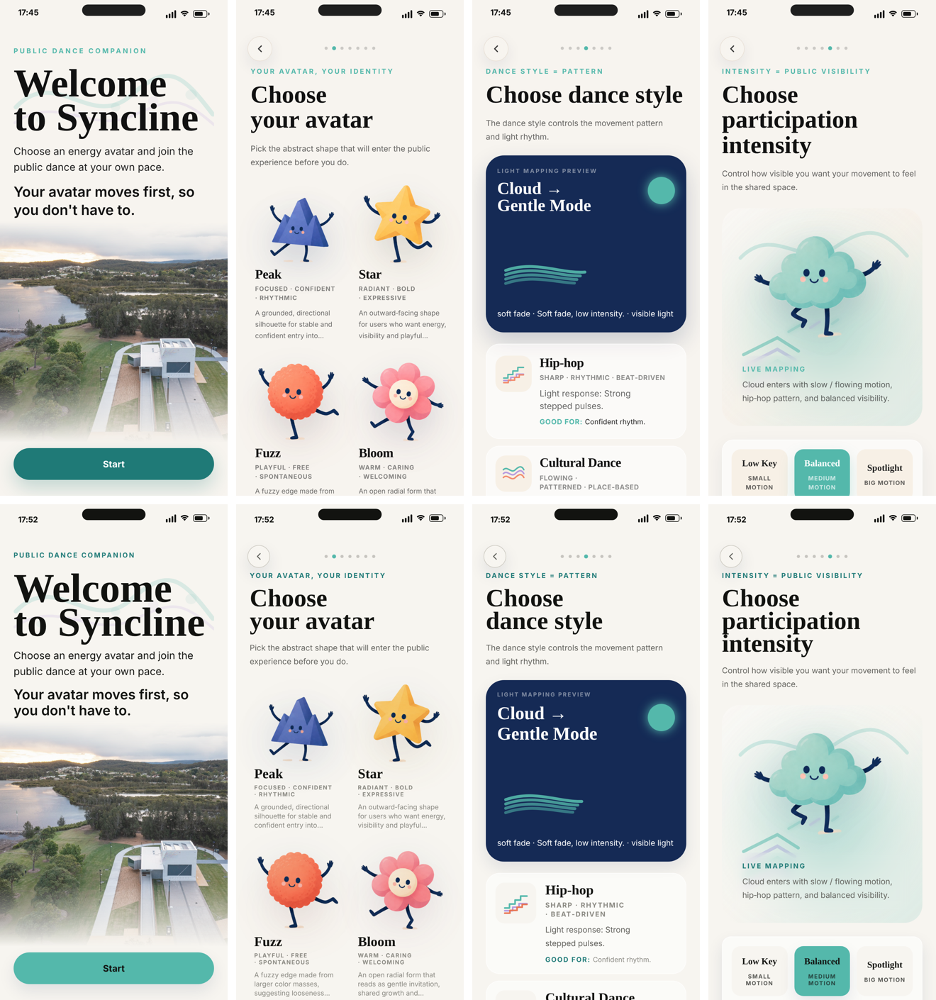
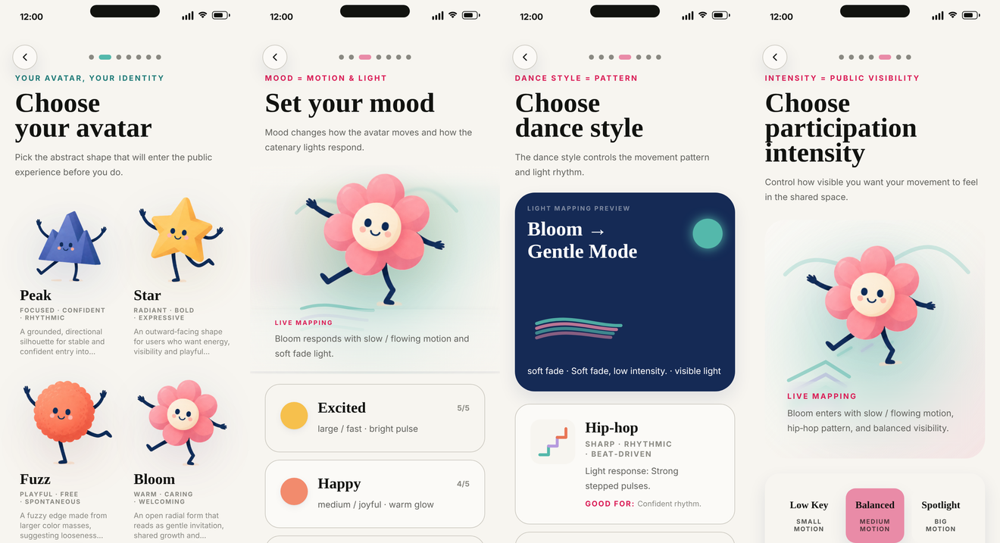

# Week 2 · Day 4 · 原型换 token

目标：Syncline 原型跑在底座 token 上，视觉不变，换一个 token 整个 app 跟着变。源码现在在 `Portfolio_Website/syncline/`（之前只有构建产物），`npm run build && npm run sync` 产出 `public/syncline-app/`。



上排 before，下排 after。差别只有三处，而且都是系统要求的：主按钮从 strong 填充 + 白字改成 base 填充 + ink 字（和 Figma 的 Button 一致）；teal 眉标从 `#54B8AB`（2.3:1）改成 `fg/accent`（4.5:1）；浮动按钮从 64 下移到 `rhythm/3` 72 对齐基线行。

## 做了什么

### 1 · Tailwind 主题指向 token（`tailwind.config.js`）

不是 extend 一些颜色名，而是**整个刻度替换**：`fontSize` 只剩 12 个 tier（`text-sm` = body 14/24，`text-2xl` = h3 24/28，`text-display-3` …），`borderRadius` 只剩 `rounded-1…5/full`，`boxShadow` 只剩 `shadow-1/2/3`，`letterSpacing` 5 档，`transitionDuration` / `TimingFunction` 4 + 4。Tailwind 默认刻度里不在底座上的值（`rounded-xl`、`shadow-lg`、`text-5xl`、`leading-tight`…）**在这个项目里不存在**，写了也不生效。这比"约定不要用"可靠得多。

颜色走 `rgb(var(--x-rgb) / <alpha-value>)`，所以 `bg-accent/15`、`bg-canvas/88` 这种透明度写法照常工作——`build.py` 现在给每个 hex 颜色多发一个 `-rgb` 三元组。

间距：Tailwind 的 `p-4` = 1rem 本来就和 `space.4` 同刻度，直接把 1–12 键指向 `--space-*`；另外加了 `icon-sm/md/lg`、`control-md/lg`、`touch`、`rhythm-1…4`。

### 2 · App.tsx 换值（脚本化，有日志）

| | before | after |
| --- | --- | --- |
| hex 字面量 | 17 个不同值，189 次 | **0** |
| `bg/text/border-[#…]` 任意值 class | 26 种，109 次 | 0 |
| `shadow-[…]` 任意值 | 18 种，22 次 | 0（`shadow-1/2/3`） |
| `rounded-[Npx]` | 10 种，24 次 | 2（手机边框 46、状态栏图标 2） |
| `text-[N rem]` | 9 种，16 次 | 0（tier） |
| `leading-*` | 8 种，28 次 | 0（行高由 tier 带，全是 4 的倍数） |
| `tracking-[…]` | 9 种，18 次 | 0（5 档 token） |
| 字体层 | 3 层互相覆盖（Inter → SF Pro → New York） | 2（`--font-body` Inter、`--font-display` New York / Georgia） |
| 构建后打的补丁 | 3 个文件 21.8 KB，用 DOM 改样式 | 0 —— 并进源码，样式部分全部 token 化 |

映射规则（`docs/04-color.md` 的角色表）：`#1F1F1F / #111111` → `fg/primary`；`/70` 的 ink → `fg/secondary`；`/45–/60` → `fg/muted`；`#54B8AB` 作为文字 → `fg/accent`（strong），作为填充 → `accent`；`#152A55` → 新增主题层 `scene.night`（不是 `bg/inverse`，它刻意是海军蓝）；`#F7F0E6` → `bg/surface`；`#E8E0D6` → `border/subtle`；`#A8B9C8` → `action/disabled-bg` / `border/control`；六个 form 色 → `--form-*`。inline SVG 插画里的颜色也全换成 `var(--form-*)` / `var(--scene-night)` / `var(--bg-raised)`，`data.ts` 的颜色字段同样是 var 字符串——它们只进 `style` / `stroke` / `drop-shadow()`，CSS 变量在这些位置都生效。

scene 容器的 `min-h` 吸附到整行（330 → 336、285 → 288、410 → 408、450 → 456、500 → 504）。

### 3 · 补丁并进源码

`hig-refinements.css` 307 行 → `src/styles/refinements.css` 178 行，留下的只有行为（页面不做过渡、page control、save 流程的 a11y、Saved Moment 全屏），值全是 token。删掉的：SF Pro 字体栈、按选择器覆盖字号行高（tier 接管）、44px 按钮覆盖（Icon button 是 40 + 44 命中区，`icons.css`）、DOM 现画的舞种图。两个 JS 补丁改成 `src/refinements/*.js`，由 `main.tsx` 引入；`refineDanceStyleIcons` 删掉。

### 4 · Pictogram 从生成文件来

`DanceGlyph` 原来 100 行 JSX 按舞种现画。现在 12 行：从 `pictograms.generated.js`（= `dist/syncline/pictograms/pictograms.js`）取 `hiphop` / `hiphop-active`，塞进 `.pictogram` 容器（`rhythm/3` 方、`radius/3`、空闲 `bg/surface` / 激活 `scene.night`）。Figma 的 `Pictogram` 和这里是同一份 JSON。

### 5 · `data-energy`：选一个 form，整个 app 变色

`PhoneShell` 加了 `data-energy={avatar.id}`（未选时 cloud）。`tokens.css` 的 `[data-energy="bloom"]` 作用域把 `--accent-*`、`--action-primary*`、`--fg-accent` 全部重指向该 form——眉标、进度点、主按钮、选中态卡片一起换。这就是 Week 3 `/syncline` 子页顶部切换器要演示的东西，代码一行都不用加。



### 5½ · 进度点换成真组件

原来的页面进度点是补丁里用 `section::before / ::after` 画的七个 radial-gradient，JS 再按标题文字算偏移——和 Figma 的 `Page control` 没有关系。现在是 `<PageControl>`：7 个 `span`，未激活 `space/2` × `border/control`，激活拉长到 `space/5` × `action/primary`，间距 `space/2`，`duration/base` + `easing/enter` 过渡，带 `role="progressbar"`。Figma 的 `Page control` 同步补到 7 个点、Active=1–7。

### 6 · 结构

```
Portfolio_Website/
  syncline/                 ← 源码（新）
    src/styles/tokens/      ← tokens.css + icons.css，从 c1xx-foundations 复制
    src/pictograms.generated.js
    src/refinements/        ← 原来的 DOM 补丁
    tailwind.config.js      ← 全部指向 token
  public/syncline-app/      ← npm run sync 的产物，网站 iframe 嵌入
```

刻意保留的字面量：手机边框（402 × 874、`rounded-[46px]`、10px ring）、玻璃层的 `white`、遮罩里的 `rgba(0,0,0)`。

## 还没做 / Day 5 看

- framer-motion 的 `transition={{ duration: 0.22 }}` 这类 JS 时长还是数字，可以读 `motion.json` 的 `gsap.*` 秒值。
- 剩下的 JS 补丁（save 流程的 a11y 属性）是按 DOM 查找改的，正确的做法是写进 JSX。行为没变，先留着。
- 浮动返回按钮的描边 `border/subtle` 比原来的 `#E8E0D6` 重一档，Day 5 对 Figma 时决定要不要给 Icon button 的 glass 变体单独定描边。

## 修复 · 桌面浏览器里标题过大（10/24）

`--display-N-size` 按浏览器窗口的断点切换。原型单独打开时窗口是 1440 宽，手机壳 402 宽，标题拿到桌面档 128px，撑出屏幕。Syncline 只存在于手机里，所以：

- `build.py` 额外输出每档 display 的移动端固定值 `--display-N-size-mobile` / `--display-N-lh-mobile`
- 原型的 `PhoneShell` 加 `data-device="phone"`，在这个作用域里把 `--display-N-*` 指向 `-mobile`

结果：任何窗口宽度下，手机壳里的 display-1 都是 72/60。
